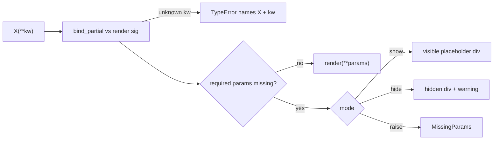
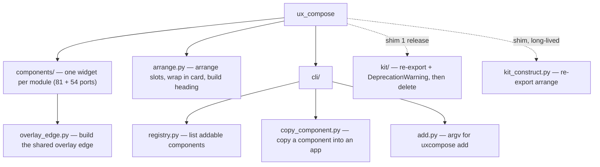

# Spec: component parameters, placeholders, and readymade components in the kit

Status: **RED, tests only.** This PR adds failing tests and this spec. It contains no fix code, moves no modules and changes no public API.
Base: `main` @ `97078e9`. Full-suite baseline on main: **693 passed** (py3.14, `pytest tests/ -q`).

## 1. Hierarchy

```mermaid
graph TD
  core[ux_compose.Component<br/>binds call-site args → render signature]
  ph[ux_compose.placeholder<br/>mode: show / hide / raise]
  kit[src/ux_compose/components/ — 81 moved from kit<br/>+54 ported examples (Q3: +16 clashes)]
  cat[kit/catalog.py CATALOG]
  add[uxcompose add <slug> → app/components/<slug>.py]
  ex[examples/ — unchanged, stays as demos]
  core --> ph
  kit --> core
  cat --> kit
  add --> cat
  ex -. later may import kit (Q4) .-> kit
```

## 2. Parameters: render args like a normal Python function

**The pattern** comes from bitplorer/uidom, `uidom/dom/src/component.py:47-54`: `__init__(*args, **kwargs)` calls `self.render(*args, **kwargs)`. Components declare their data in the render signature, e.g. `uidom/elements/integers.py:271`, which is `def render(self, *args, label, name, placeholder, type, **kwargs)`. They're called as `SubmitButton(label="Submit", value="submit")` (`apps/app/login.py:36`). ux-dom (the successor) does the same thing (`ux_dom/dom/src/component.py:168-175`, `ui/badge.py:23`).

**Decision P1 (this replaces PLAN D1 and D2):** the **render signature is the parameter contract**, as Shivam described. `Component.__init__(*args, **kwargs)` binds the arguments with `inspect.signature(render).bind_partial` and stores them on `self._params`. `__render__` calls `render(*args, **params)` on every render and morph, so the parameters survive re-renders. Arguments passed explicitly to `render()` override the bound ones.
- Why: it keeps uidom's mental model (data in, function-style) and fixes the one gap, which is that compose re-renders on morph.
- Positives: there's no second declaration (no `_SEAMS` and no Props class). Python itself reports unknown or missing arguments. The kit's `render(*, shell=None, **slots)` keeps working because the slots are already render keyword arguments.
- Negatives: this adds a constructor signature to the base class (critical, Q1). Bound parameters are separate from MorphState, so changing a parameter later means re-constructing the component.
- Effect: `Greeting(title="Hi")` works, and `Badge(items=...)` equals `Badge().render(items=...)`.
- Assumptions: unidentified U1, whether the framework constructs components itself with zero arguments (register, Channel or session restore). Zero arguments stays valid, and missing parameters show a placeholder.

## 3. Placeholders

| | Decision |
|---|---|
| Trigger | `render` has required (no default) params not supplied |
| Look (show) | `<div id="{self.id}" data-ux-placeholder="Greeting" data-ux-missing="subtitle,title" role="note" aria-label="Greeting placeholder: missing subtitle, title" class="border border-dashed ...">Greeting · missing: subtitle, title</div>` |
| A11y | `role="note"` and an `aria-label` give screen readers the same text. The visible text isn't colour-only. |
| Morph | keeps `id=self.id`, so a later render with data morphs in place |
| hide | `<div id=... hidden></div>`. No component or param names in the markup, and a `MissingParamsWarning` is emitted once per class. |
| raise | `MissingParams(TypeError)` names the component and the params |
| Default | **hide** (safe for production). **show** is set by `uxcompose serve dev`, the Atelier and tests (Q2 asks whether that default is right). |
| Kit | the same `placeholder_for(inst, missing)` helper. Kit classes have demo defaults today, so they only show a placeholder for params that become required (Q5). |
| Performance | the signature is cached per class on first use. The complete-data path does one dict lookup, and the placeholder code is only reached when something is missing. A bench test is in the plan (T6). |

Mode is set with `use_placeholder_mode("show"|"hide"|"raise")` (context manager) or the env var `UX_COMPOSE_PLACEHOLDERS`.



## 4. Readymade components in the kit (examples/ untouched)

`uxcompose add` copies from `src/ux_compose/kit/<stem>.py`, registered in `kit/catalog.py:CATALOG`, into `app/components/` (`cli/add.py:10-11`, `kit/copy.py:191`). This was verified live: all 81 CATALOG entries add into a fresh `create-app` tree, and the 85 copied files import with 0 failures. **`add` is not broken today.**

**Would it break with ports?** Yes, for 3 reasons, and each one now has a red test:
1. The example classes import `examples._common`. `copy.py` only rewrites `ux_compose.kit` imports, so a copied file would fail with ImportError in a user app. Fix: ports import `ux_compose.author`, which is the public home of the same 7 helpers. `examples/_common.py` already re-exports exactly those objects, and the guard test proves it.
2. They have no CATALOG entry, so `add counter` reports an unknown component. Fix: add CATALOG rows.
3. There are 16 name clashes (Accordion, Banner, BottomNav, Calendar, Carousel, Chat, Combobox, Drawer, Dropdown, Popover, Rating, Skeleton, Stepper, Tabs, Timeline, Tree), so the same slug would point at two classes. This is held for Q3.

Ports: 54 non-clashing classes become `kit/<name.lower()>.py`. `examples/*.py` stay byte-identical, so no rename and no move.


## 5b. Kit: what it is, current structure, proposed structure

**What the kit is for:** ownable drop-in widgets, shadcn-style. `uxcompose add <slug>` copies the source into `app/components/` so the product owns and edits it. `from ux_compose.kit import X` stays available for tests, the Atelier and agents (`kit/__init__.py` docstring). **The examples do not use the kit at all**: there's no `ux_compose.kit` import in `examples/*.py`, only prose mentions in `examples/catalog.py:928-931`. The examples are separate teaching units built directly on `Component` and `author`.

**Current structure and the problem each module solves:**

| Module | One-line purpose (from its docstring) | Issue |
|---|---|---|
| `kit/<81 widgets>.py` | one ownable widget each | clean |
| `kit/__init__.py` | public `from ux_compose.kit import X` surface | clean |
| `kit/overlay.py` | shared overlay edge (ids, swipe-dismiss) used by several widgets | a helper, not a widget, but public (`overlay`, `OverlayEdge`) |
| `kit/catalog.py` | registry of ownable widgets for the CLI and docs | CLI tooling inside the widget package. `copy.py` needs `_TOOLING_STEMS={"catalog","copy"}` to skip it (overlap) |
| `kit/copy.py` | copies kit sources into an app | same as above |
| `kit_construct.py` | `apply_slots` / `kit_shell` host seam | sits outside `kit/` on purpose: copied files import it from the library. The name is fine |
| `author.py` | public helpers (`act`, `mark_dirty`, ...) | duplicated by name in `examples/_common.py`, but as re-exports, not a copy (no real overlap) |
| `helpers.py` | Ops/Plans helpers | vague name, but a public import path used by 34 files |
| `surfaces.py` / `kit/catalog.py` / `examples/catalog.py` | three different "catalog"s | naming overlap only. Examples can't be renamed (Shivam), so only the kit one moves |

**Proposed structure (t134u: retire `kit/`).** Each definition moves to a packaged home named for what it is. `ux_compose.kit` turns into a warning re-export shim for one release and is then deleted.

Where it's used: of the 81 kit classes, only 10 are used by product code (`apps/pulseboard/widgets.py:27-36`). The rest are used only by tests, the Atelier and `uxcompose add`. `apps/` isn't packaged, so moving definitions "into the app that uses them" would break `add` for everyone else. Each widget therefore gets its own module in the package. This interpretation needs Shivam's yes (**Q8**).

### Move map

| Old | New | Notes |
|---|---|---|
| `ux_compose/kit/<slug>.py` (81 widgets) | `ux_compose/components/<slug>.py` | one widget per module, slug unchanged |
| `ux_compose/kit/overlay.py` (`overlay`, `OverlayEdge`) | `ux_compose/components/overlay_edge.py` (`build_overlay_edge`, `OverlayEdge`) | `overlay` kept as an alias for one release |
| `ux_compose/kit/catalog.py` | `ux_compose/cli/registry.py` | tooling leaves the widget package; `_TOOLING_STEMS` hack deleted |
| `ux_compose/kit/copy.py` | `ux_compose/cli/copy_component.py` | copies from `components/` |
| `ux_compose/kit_construct.py` (`apply_slots`, `kit_shell`) | `ux_compose/arrange.py` (`arrange_slots`, `wrap_in_card`) | `kit_construct` stays as a shim **longer than one release**: files already copied into user apps import it (Q9) |
| `ux_compose/kit/__init__.py` (81 re-exports) | thin shim: `from ux_compose.components.<slug> import X` and a `DeprecationWarning` | deleted after one release (Q10) |
| 54 example ports (§4) | `ux_compose/components/<name.lower()>.py` | `examples/` untouched |

### Extracted verb-named helpers (`ux_compose/arrange.py`, purpose: "arrange a widget's data and chrome")
| Helper | Replaces | Repeats today |
|---|---|---|
| `arrange_slots(inst, *, seams, shell, **slots)` | `kit_construct.apply_slots` | 80 widgets |
| `wrap_in_card(inst, *unit, heading=(), **attrs)` | `kit_construct.kit_shell` | 77 widgets |
| `build_heading(kicker, title, lede)` | inline `preface=(span(..kicker), h2(..title), p(..lede))` | 71 widgets |
| `HEADING_KICKER / HEADING_TITLE / HEADING_LEDE` tokens | `class_kicker/title/lede` strings | 78 copies, only 3, 5 and 7 distinct values |

The instance-level `class_*` attributes stay as overridable class attributes. Only their defaults point at the tokens, so subclass styling keeps working (rule K4).



### Consumers to update (from `rg ux_compose.kit`)
`cli/add.py`, `doctor.py`, `kit_construct.py`, `apps/pulseboard` (2 files), `apps/nook` (1), tests (17 files), docs (5 files), and the repo root (1). Renaming imports in tests and apps is part of the move PR. The shim keeps old imports working either way.

### `add` after the move
`copy_component` reads from `components/<slug>.py` and rewrites `from ux_compose.components.X import` to `from .X import`. Copies import `ux_compose.arrange`. The test `test_add_copies_from_components_without_kit_imports` is red now.

- **K1** Move tooling to `cli/registry.py` and `cli/copy_component.py` with shims. **Critical (Q6).**
- **K2** Keep `author` and `helpers` named as they are (Q7: no rename).
- **K3** Every module has a one-line docstring purpose (guard).
- **K4** Extract the helpers, but keep `class_*` attributes as overridable class attributes. Positive: about 220 duplicated lines go, and styling stays overridable. Negative: widgets import one more module. Non-critical.

## 5c. Examples: thin wrappers and kit-named helpers (t135u)

**Review (AST scan of every `examples/**/*.py`):**
- **No kit-named function or class exists in `examples/`.** The only "kit" mentions are prose in `examples/catalog.py:928-931`. The examples don't import `ux_compose.kit`.
- Functions whose entire body is `return <call>(...)`:
  - `lists.py:85 Shelf._plan`: a motion plan, not a tag, used 3 times.
  - `table_board.py:117 Kanban._col`: a tuple-to-list read, not a tag, used 3 times.
  - Both are genuinely reused and build no div, so they **stay**.
- Helpers from `examples/_common.py`, which re-exports the public `ux_compose.author`:

  | Helper | Calls in examples | Files | Decision |
  |---|---|---|---|
  | `act` | 178 | 16 | keep (reused) |
  | `mark_dirty` | 81 | 12 | keep |
  | `field` | 13 | 5 | keep |
  | `status` | 5 | 4 | keep |
  | `optional_plan` | 8 | 5 | keep |
  | `optional_slide` | 5 | 2 | keep |
  | `optional_fade` | 3 | 2 | keep |

  All are reused across files, and all are public `ux_compose.author` API. Renaming them to verbs (e.g. `build_field`) would be a public API change, so it's **not done**. If wanted, it would be a separate critical question (Q11).
- `examples/_common.py` itself is a re-export module, not a wrapper function. It stays, because `tests/unit/test_architecture_public_api.py:66,85` imports it, and because removing it would mean editing all 16 example files (Shivam said examples/ is not moved or renamed).

**Result: 0 wrappers inlined, because none met the rule.** The only change is module purpose. The two `routes/__init__.py` files had no docstring: one had a `#` comment and the other was empty. They now carry one-line docstrings, and the original comment's content is kept.

**Guard:** `tests/unit/test_examples_structure.py`:
- `test_every_example_module_has_one_line_purpose` was red, now green.
- `test_no_kit_named_helpers_in_examples` is a guard.
- `test_no_thin_tag_wrappers_used_once` is a guard: a helper whose whole body is `return <tag>(...)` and that is used at most once must be inlined.

Full suite:
- Before this change, on the branch: 132 failed, 703 passed. The existing 693 tests pass (693 passed when the new spec files are deselected).
- After: 131 failed, 704 passed. The 131 failures are only the intended red specs from §2-5b.

## 5. Step → test → doc map

| Step | Tests (red now) | Doc |
|---|---|---|
| S1 param binding in Component | `tests/unit/test_component_params.py` (7 red, 2 guard) | this spec §2, `docs/guides/UI.md` |
| S2 placeholder module + modes | `tests/unit/test_placeholders.py` (8 red, 2 guard) | §3 |
| S3 `_common` helpers → `kit_construct` | covered by `test_add_copies_runnable_port` | §4 |
| S4 port 54 examples into kit + CATALOG | `tests/unit/test_component_ports.py` (108 red, 3 guard) | §4, `uxcompose add --list` |
| S4b retire kit, extract helpers (§5b) | `tests/unit/test_components_structure.py` (7 red, 2 guard) | §5b |
| S4c examples: no thin wrappers, module purposes (§5c) | `tests/unit/test_examples_structure.py` (1 red→green, 2 guard) | §5c |
| S5 clashes (after Q3) | new tests once decided | §4 |
| S6 perf bench (ctor and render vs main, <5%) | to write with S1 | §3 |

Every step: run the full suite before and after (baseline 693 passed), then PR, independent review, Shivam's merge decision.

## 6. Decisions taken here (non-critical)
- **P2** Unknown kwargs raise TypeError naming the class. Positive: no silent typos. Negative: stricter than uidom's `**kwargs` passthrough. Applies only when render has no `**kw`.
- **P3** Placeholder `data-ux-missing` is sorted and comma-joined, so output is deterministic for golden tests.
- **P4** Hide mode keeps a hidden root with an id, so the morph target survives and nothing leaks.
- **P5** Port slug = `ClassName.lower()`, matching the existing `stem == name.lower()` rule (`test_cli_add.py:36`).
- **P6** Tests are plain unit tests, not `cto_red`, so the red is visible in CI on this draft PR. CI will be red until the fixes land, and that's intended.

## 7. Critical questions for Shivam (yes/no)
- **Q1** Should the base `Component.__init__` accept args bound to `render`'s signature? **Recommend yes.**
- **Q2** Default placeholder mode **hide**, with **show** only in serve dev, the Atelier and tests? **Recommend yes.**
- **Q3** For the 16 clashes, keep the kit class and port the example under a descriptive new name (e.g. `TabsPresence`)? **Recommend yes.** The alternative is to merge example behaviour into the existing kit class.
- **Q4** Later, should `examples/*.py` import the kit ports instead of duplicating them (files stay where they are, no rename)? **Recommend yes, in a later PR.**
- **Q6** Should `kit/catalog.py` and `kit/copy.py` move to `cli/registry.py` and `cli/copy_component.py`, with deprecation shims kept for one release? **Recommend yes.**
- **Q7** Should `helpers.py` be renamed (e.g. to `ops.py`)? **Recommend no**: it's public and imported by 34 files, and the churn isn't worth it.
- **Q8** Should every kit widget move to `ux_compose/components/<slug>.py`, given that "where used" isn't possible for the 71 with no product consumer and `apps/` isn't packaged? **Recommend yes.**
- **Q9** Should the `kit_construct` shim outlive the one-release rule, because files users already copied import it? **Recommend yes**, e.g. two releases plus a `doctor` warning.
- **Q10** Should `ux_compose.kit` be deleted after one release of warning re-exports? **Recommend yes.**
- **Q11** Should the public `ux_compose.author` helpers (`act`, `field`, `status`, `optional_*`) be renamed to verb names, with shims? **Recommend no**: they're reused 293 times, and their current names already describe the result.
- **Q5** Should kit components drop their demo defaults so empty use shows a placeholder? **Recommend no**, because it would break 81 public components. Keep the defaults and show placeholders only for genuinely required params.
